# IntelliShield SDN — Formal UML Use Case Model Specification

This document provides the formal software architecture specification for the **IntelliShield SDN UML Use Case Diagram**, incorporating **Actor Generalization**, **Use Case Generalization (Specialization)**, **`«include»` mandatory dependencies**, and **`«extend»` conditional workflows**.

---

## 1. Diagram Downloads & Locations

| Asset | Desktop Location | Project Path | Description |
| :--- | :--- | :--- | :--- |
| **Draw.io XML** | [`C:\Users\deshm\OneDrive\Desktop\intellishield_use_case_diagram.drawio`](file:///c:/Users/deshm/OneDrive/Desktop/intellishield_use_case_diagram.drawio) | [`docs/architecture/intellishield_use_case_diagram.drawio`](file:///c:/Users/deshm/OneDrive/Desktop/intellishield_sdn-main/docs/architecture/intellishield_use_case_diagram.drawio) | Fully editable XML for [diagrams.net](https://app.diagrams.net/) |
| **High-Res PNG** | [`C:\Users\deshm\OneDrive\Desktop\intellishield_use_case_diagram.png`](file:///c:/Users/deshm/OneDrive/Desktop/intellishield_use_case_diagram.png) | [`docs/architecture/intellishield_use_case_diagram.png`](file:///c:/Users/deshm/OneDrive/Desktop/intellishield_sdn-main/docs/architecture/intellishield_use_case_diagram.png) | Publication-grade 300 DPI graphic |
| **Vector SVG** | [`C:\Users\deshm\OneDrive\Desktop\intellishield_use_case_diagram.svg`](file:///c:/Users/deshm/OneDrive/Desktop/intellishield_use_case_diagram.svg) | [`docs/architecture/intellishield_use_case_diagram.svg`](file:///c:/Users/deshm/OneDrive/Desktop/intellishield_sdn-main/docs/architecture/intellishield_use_case_diagram.svg) | Infinite-resolution vector graphic |

---

## 2. Actors & Actor Generalization

1. **Security Analyst / SOC Operator (`actor_analyst`):**
   - **Role:** Observability, entropy analysis, ML alert inspection, evidence correlation, and log auditing.
2. **Network Administrator (`actor_admin`):**
   - **Role:** Controller governance, OpenFlow mitigation enforcement, threshold tuning, and AutoML model management.
3. **Actor Generalization (`Network Administrator` $\longrightarrow^\triangle$ `Security Analyst`):**
   - The Network Administrator **inherits all capabilities and observational permissions** of the Security Analyst, while holding exclusive control-plane enforcement privileges.

---

## 3. Comprehensive UML Relationships

```mermaid
graph TD
    classDef base fill:#ffffff,stroke:#1e293b,stroke-width:2px;
    classDef inc fill:#f0f9ff,stroke:#0284c7,stroke-width:2px,color:#0369a1;
    classDef ext fill:#fef3c7,stroke:#d97706,stroke-width:2px,color:#b45309;
    classDef gen fill:#f8fafc,stroke:#475569,stroke-width:1.5px,color:#334155;

    %% Detection Subsystem
    UC3["Detect DDoS Attacks via Hybrid Framework"]:::base
    UC_FE["Extract 15-D Flow Features & Spatial Metrics"]:::inc
    UC2["Analyze Shannon Traffic Entropy"]:::inc
    UC3a["Supervised Ensemble ML (RF / XGB)"]:::gen
    UC3b["Deep Autoencoder Anomaly (Zero-Day)"]:::gen
    UC7["View XAI Threat Attribution & Root Cause"]:::ext

    UC3 -.->|«include»| UC_FE
    UC3 -.->|«include»| UC2
    UC3a -->|Generalization| UC3
    UC3b -->|Generalization| UC3
    UC7 -.->|«extend»| UC3

    %% Verification Subsystem
    UC4["Correlate & Fuse Cross-Layer Signals"]:::base
    UC5["Verify Suspicious Traffic (Multi-Stage Streak)"]:::inc
    UC4 -.->|«include»| UC5

    %% Mitigation Subsystem
    UC9["Apply & Enforce OpenFlow Mitigation Rules"]:::base
    UC_AL["Verify Infrastructure Allowlist (ARP, DNS)"]:::inc
    UC_TCAM["Manage TCAM Rule Expiration (idle/hard)"]:::inc
    UC9a["Surgical FLOW_PAIR DROP"]:::gen
    UC9b["Meter Band Rate Limiting"]:::gen
    UC9c["Temporary Port Quarantine"]:::gen
    UC8["Review Quarantined & Blocked Flows"]:::ext

    UC9 -.->|«include»| UC_AL
    UC9 -.->|«include»| UC_TCAM
    UC9a -->|Generalization| UC9
    UC9b -->|Generalization| UC9
    UC9c -->|Generalization| UC9
    UC8 -.->|«extend»| UC9

    %% Adaptation Subsystem
    UC10["Configure Monitoring & Drift Thresholds"]:::base
    UC10_ext["Trigger AutoML Retraining & Model Promotion"]:::ext
    UC10_ext -.->|«extend»| UC10
```

---

### Detailed Breakdown of Relationships:

#### 1. `«include»` Dependencies (Mandatory Sub-tasks)
- **`Detect DDoS Attacks` $\xrightarrow{\text{«include»}}$ `Extract 15-D Flow Features`**: Telemetry parsing and feature vector calculation must execute before classifier inference.
- **`Detect DDoS Attacks` $\xrightarrow{\text{«include»}}$ `Analyze Shannon Traffic Entropy`**: Ultra-lightweight Level-1 Shannon entropy screening ($H < 0.5$) is always computed first to filter normal traffic and detect volumetric distribution collapse.
- **`Correlate & Fuse Cross-Layer Signals` $\xrightarrow{\text{«include»}}$ `Verify Suspicious Traffic`**: Cross-layer signal correlation always executes multi-stage streak confirmation (`attack_confirm >= 2`) to eliminate false alarms from transient legitimate spikes.
- **`Apply & Enforce OpenFlow Mitigation Rules` $\xrightarrow{\text{«include»}}$ `Verify Infrastructure Allowlist`**: Mitigation routines unconditionally check core infrastructure allowlists (broadcast MAC `ff:ff:ff:ff:ff:ff`, gateway IP, ARP) before installing drop rules.
- **`Apply & Enforce OpenFlow Mitigation Rules` $\xrightarrow{\text{«include»}}$ `Manage TCAM Rule Expiration`**: All installed flow mods unconditionally set `idle_timeout=30s` and `hard_timeout=60s` to prevent switch TCAM exhaustion.

#### 2. `«extend»` Dependencies (Conditional Extensions)
- **`View XAI Threat Attribution` $\xrightarrow{\text{«extend»}}$ `Detect DDoS Attacks`**: When an attack is flagged, an operator or auditor can optionally invoke SHAP feature attribution to view plain-language root-cause metrics.
- **`Review Quarantined & Blocked Flows` $\xrightarrow{\text{«extend»}}$ `Apply & Enforce OpenFlow Mitigation Rules`**: While mitigation rules are active, operators can inspect and manage isolated flow pairs from the SOC console.
- **`Trigger AutoML Retraining & Model Promotion` $\xrightarrow{\text{«extend»}}$ `Configure Monitoring & Drift Thresholds`**: When concept drift exceeds configured tolerance, the system triggers the shadow-mode AutoML retraining and promotion pipeline.

#### 3. Generalization / Specialization ($\triangle$)
- **Detection Strategies:**
  - `Supervised Ensemble ML (Random Forest / XGBoost)` specializes `Detect DDoS Attacks` (tailored for known volumetric signatures).
  - `Deep Autoencoder Anomaly (Zero-Day SSL Flood)` specializes `Detect DDoS Attacks` (tailored for novel, unobserved attack patterns).
- **Mitigation Enforcement Strategies:**
  - `Surgical FLOW_PAIR DROP Rule` specializes `Apply & Enforce OpenFlow Mitigation Rules` (granular 5-tuple drop).
  - `OpenFlow Meter Rate Limiting` specializes `Apply & Enforce OpenFlow Mitigation Rules` (bandwidth throttling via meters).
  - `Temporary Port Quarantine` specializes `Apply & Enforce OpenFlow Mitigation Rules` (emergency port isolation).
