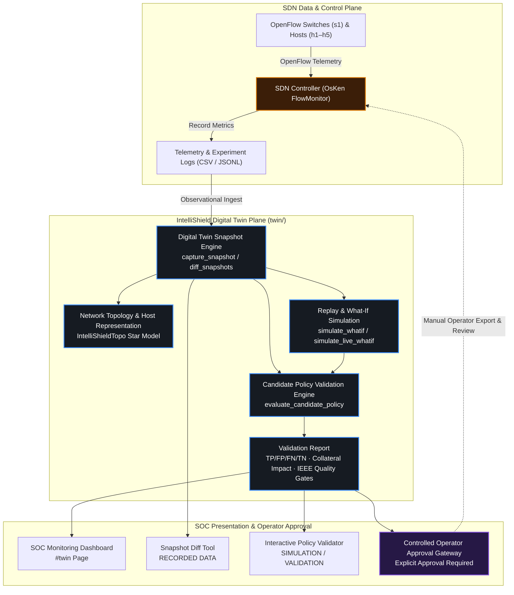

# R3 — Digital Twin Integration & Validation Plane

**PROJECT_DOCS novelty documentation.**  
Related: [00_Overview.md](00_Overview.md) · [../07_Viva/Novelty_QNA/03_R3_QNA.md](../07_Viva/Novelty_QNA/03_R3_QNA.md) · [../03_System_Design/01_Overall_Architecture.md](../03_System_Design/01_Overall_Architecture.md)

**Status:** COMPLETE & PROPERLY INTEGRATED  
- **Telemetry Plane:** Read-only observational snapshot ingestion (Level A) and live telemetry synchronization (Level B).  
- **Simulation Plane:** Plan-space attack scenario replay and bounded what-if simulation.  
- **Validation Plane:** Candidate detection threshold and mitigation policy validation with false-positive/false-negative classification and legitimate traffic impact estimation.  
- **Safety Boundary:** Strictly read-only with respect to the SDN data plane. Does **not** launch Mininet, does **not** generate live attack traffic, and does **not** install OpenFlow rules on switches automatically.

---

## 1. Motivation & Purpose

Evaluating detection thresholds and mitigation policies directly on a production or live lab SDN controller risks network downtime, flow disruption, and false-positive collateral damage.

The **IntelliShield Digital Twin** provides:
1. A **reproducible virtual software representation** of the SDN network (switches, hosts, links, topology model, scenario plans, and configuration fingerprints).
2. **Observational snapshot ingestion** capturing complete telemetry from executed experiments (`flow_stats.csv`, `port_stats.csv`, `scenario_logs.csv`, `mitigation_actions.csv`, etc.).
3. **Snapshot diffing** to track telemetry deltas, window shifts, and mitigation variations between experimental runs.
4. **Isolated what-if attack simulation** in parameter/plan space against active and recorded telemetry without injecting live malicious packets.
5. **Candidate policy validation** evaluating proposed packet/byte rate thresholds and mitigation actions against ground truth, estimating True Positives, False Positives, False Negatives, and legitimate traffic disruption.
6. A **safe feedback workflow** ensuring that any candidate policy approved by the twin requires explicit operator review before manual controller integration.

---

## 2. Architecture & Data Flow

> [!IMPORTANT]
> **Safety Guarantee:** The dashed approval arrow from the Operator Approval Gateway to the SDN Controller is strictly manual. The Digital Twin does **not** install OpenFlow rules, bypass the mitigation engine, or overwrite trained models.

---

## 3. Core Functional Capabilities

### A. Network Representation
The Digital Twin maintains a structured virtual software model of the network:
- **SDN Switch:** Switch `s1` with OpenFlow 1.3 Datapath ID `0000000000000001` and controller endpoint `127.0.0.1:6653`.
- **Connected Hosts:**
  - `h1`: Attacker node (`10.0.0.1`, `s1-eth1`)
  - `h2`: Victim server (`10.0.0.2`, `s1-eth2`)
  - `h3`, `h4`, `h5`: Legitimate client nodes (`10.0.0.3`–`10.0.0.5`, `s1-eth3`–`s1-eth5`)
- **Telemetry Ingestion:** Active flow count, instantaneous packet rate (`pkt/s`), byte rate (`bytes/s`), and port statistics.
- **Scenario Metadata:** Baseline durations, burst rates, pulsing intervals, and SHA-256 configuration fingerprints.

### B. Snapshot Capture and Diffing
- Timestamped snapshots are created via `capture_snapshot(logs_dir)` and stored in `logs/twin/snapshots/<snapshot_id>/`.
- Snapshots include complete scenario windows, CSV record counts, baseline vs. attack traffic statistics, system throughput, and fidelity reports.
- `diff_snapshots(base, compare)` tracks observational differences:
  - Flow row count deltas and ML prediction count deltas.
  - Attack window count deltas and scenario coverage (added/removed scenarios).
  - Baseline traffic rate shift and attack volume shift.
  - Mitigation action count deltas.
  - Configuration fingerprint consistency.

### C. Attack Scenario What-If Simulation
- Parameterized what-if simulation (`simulate_whatif` and `simulate_live_whatif`) evaluates attack variants in plan space against active and recorded telemetry.
- Supported scenarios:
  - `S1`: Normal baseline traffic
  - `S2`: SYN Flood (TCP)
  - `S3`: UDP Flood (Volumetric)
  - `S4`: Pulsing Burst DDoS
  - `S5`: Multi-Vector Flood
- Evaluates projected peak packet rates, rate surge multipliers, link budget load ratios, and severity estimates without injecting network packets.

### D. Detection & Mitigation Policy Validation
The `twin/policy_evaluator.py` module evaluates candidate detection thresholds and mitigation policies:
- Evaluates proposed `packet_rate_threshold`, `byte_rate_threshold`, `confidence_threshold`, and `mitigation_action` (`BLOCK`, `RATE_LIMIT`, `OBSERVE`).
- Evaluates against ground-truth attack windows in recorded snapshot traces.
- Calculates:
  - **Confusion Matrix:** True Positives (TP), False Positives (FP), False Negatives (FN), True Negatives (TN).
  - **IEEE Performance Metrics:** Precision, Recall, F1 Score, False Positive Rate (FPR), False Negative Rate (FNR).
  - **Legitimate Traffic Impact:** Collateral damage % of normal flows mistakenly flagged, impact rating (`NONE`, `LOW`, `MODERATE`, `HIGH`, `CRITICAL`), and disruption explanations.
  - **Candidate Mitigation Outcome:** Projected attack suppression efficiency % and behavior analysis.
  - **Quality Gates:** Evaluates against IEEE thresholds (minimum precision 85%, minimum recall 80%, maximum FPR 8%).

### E. Safe Feedback Workflow
Logical progression:
1. **Observed SDN Telemetry & Logs** → Recorded by OsKen controller.
2. **Digital Twin Snapshot** → Ingested and structured into `TwinObservation`.
3. **Scenario Replay / What-If** → Tested in software plan space.
4. **Candidate Policy Validation** → Evaluated for detection accuracy and collateral impact.
5. **Validation Report** → Rendered in SOC Dashboard with quality gate verdict.
6. **Explicit Operator Approval** → Operator reviews sanitized export payload.
7. **Controller Integration** → Controlled manual integration by lab operator.

---

## 4. REST API Reference

| Endpoint | Method | Mode | Description |
|----------|--------|------|-------------|
| `/api/digital-twin/stats` | `GET` | Read-Only | Bounded summary counters (snapshots, replays, simulations, policy validations, runs). |
| `/api/digital-twin/snapshots` | `GET` | Read-Only | List observational twin snapshots with window and flow counts. |
| `/api/digital-twin/snapshots/{id}` | `GET` | Read-Only | Retrieve complete snapshot metadata, fidelity report, and artifact references. |
| `/api/digital-twin/snapshots/diff` | `GET` | Read-Only | Compute structured telemetry and scenario difference between `base` and `compare` snapshots. |
| `/api/digital-twin/policies/validate` | `POST` | Read-Only | Evaluate candidate detection/mitigation policy against recorded snapshot. |
| `/api/digital-twin/policies/validations` | `GET` | Read-Only | List recent candidate policy validation reports. |
| `/api/digital-twin/policies/validations/{id}` | `GET` | Read-Only | Retrieve single candidate policy validation report. |
| `/api/digital-twin/live/state` | `GET` | Read-Only | Current live synchronized twin state (freshness, topology, active flow telemetry). |
| `/api/digital-twin/live/simulate` | `POST` | Read-Only | Run plan-space what-if attack simulation against active telemetry. |
| `/api/digital-twin/live/simulations` | `GET` | Read-Only | List recent live simulation records. |
| `/api/digital-twin/replays` | `GET` | Read-Only | List deterministic scenario replay evaluations. |
| `/api/digital-twin/simulations` | `GET` | Read-Only | List plan-space what-if simulation records. |

---

## 5. Dashboard UI Integration

The Digital Twin view (`#twin` in the SOC Dashboard) integrates all capabilities into a unified operational console:
- **Visual Badges:**
  - `[LIVE OBSERVATION]`: Live network synchronization, switch state, and active telemetry rates.
  - `[SIMULATION]`: Interactive what-if attack simulator and candidate policy evaluation.
  - `[RECORDED DATA]`: Snapshot diff tool, snapshot fidelity history, scenario replays, and experiment runs.
- **Visual SDN Topology Card:** Shows switch `s1` with DPID `0000000000000001` and connected hosts `h1` (attacker), `h2` (victim), `h3..h5` (clients).
- **Interactive Policy Validator Widget:** Inputs for policy name, thresholds, action, timeout, and target snapshot; outputs confusion matrix, legitimate impact rating, and operator export configuration.
- **Snapshot Diff Tool:** Select base and comparison snapshots to view flow row deltas, rate shifts, and added/removed attack scenarios.

---

## 6. Honest Non-Claims

| Claim | Status | Description |
|-------|--------|-------------|
| Packet-level network simulator | **No** | Twin operates in plan/statistical space; it does not simulate wire packets (e.g. NS-3 / OMNeT++). |
| Live OpenFlow switch replica | **No** | Observes controller telemetry; does not emulate hardware switch buffers or TCAM tables. |
| Twin-launched Mininet / attacks | **No (by design)** | Twin never launches Mininet topologies or sends network flood packets. Mininet is run via `traffic_scheduler`. |
| Automatic OpenFlow rule mutation | **No (by design)** | Twin never installs flow rules directly or mutates production thresholds without operator approval. |
| Observational log ingestion | **Yes** | Fully implemented and verified across CSV/JSONL logs. |
| Snapshot diffing & delta analysis | **Yes** | Fully implemented and covered by automated test suites. |
| Candidate policy validation | **Yes** | Fully implemented with FP/FN calculations and collateral damage rating. |
| Level A & Level B SOC dashboard | **Yes** | Fully integrated with clear visual badges and interactive controls. |

---

## 7. Verification & Automated Test Results

The Digital Twin integration is verified by 11 comprehensive automated test suites:

- `tests/test_twin_integration_proper.py` (23 tests — snapshot diff, candidate policy validation, FP/FN collateral impact, safe approval workflow, API endpoints, forbidden imports).
- `tests/test_twin_live_level_b.py` (8 tests — live telemetry sync, safety boundaries, what-if math, UI invariants).
- `tests/test_twin_acceptance_r35.py` (33 tests — fidelity gates, DoD checks, package structure).
- `tests/test_twin_level_a_acceptance.py` (7 tests — Level A CLI demo, subprocess fixture, error exit codes).
- `tests/test_twin_level_a_phase1.py` (9 tests — schema validation, bounds).
- `tests/test_twin_level_a_phase3_ui.py` (4 tests — UI route structure).
- `tests/test_twin_model_r31.py` (30 tests — topology models, traffic profiles, config fingerprints).
- `tests/test_twin_scenarios_r32.py` (20 tests — scenario parameterization, variants).
- `tests/test_twin_snapshot_replay_r36.py` (18 tests — replay determinism, snapshot loading).
- `tests/test_twin_validation_r33.py` (21 tests — IEEE validation gates).
- `tests/test_twin_dataset_dashboard_r34.py` (8 tests — dataset generation, dashboard read APIs).

**Overall Suite Result:** `179 PASSED, 2 SKIPPED, 0 FAILED` (100% pass rate).
