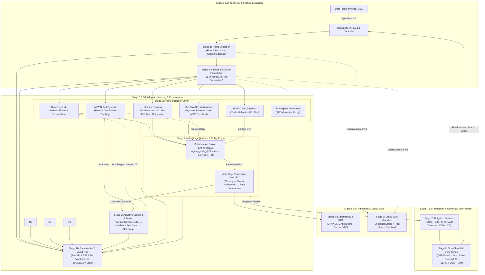

# Overall Architecture

## 1. System Purpose

IntelliShield SDN is a research-grade, closed-loop Software-Defined Networking security framework designed for robust, self-adaptive detection, verification, and surgical mitigation of Distributed Denial of Service (DDoS) attacks.

The architecture integrates **OpenFlow telemetry**, **Shannon entropy heuristics**, **hybrid machine learning**, **self-supervised learning (SSL) zero-day detection**, **concept drift monitoring (River ADWIN)**, **unsupervised behavioral clustering (HDBSCAN)**, **reinforcement learning threshold tuning (PPO)**, **reliability-aware collaborative evidence fusion**, **multi-stage verification gating**, **explainable AI with root-cause causal DAGs**, **observational and plan-space Digital Twin simulation**, and **online AutoML adaptive retraining**.

---

## 2. Architectural Style

The system follows a **layered, event-driven, hook-based, and fail-isolated** architecture:

| Style | Application in IntelliShield SDN |
|-------|----------------------------------|
| **Layered Pipeline** | 10 distinct, sequential, and interconnected stages from Data Plane to Presentation. |
| **Event-Driven & Polled** | OsKen handles OpenFlow events (`PacketIn`, `FlowStatsReply`, `PortStatsReply`, `FlowRemoved`, `StateChange`) with a 5-second polling interval. |
| **Fail-Isolated Hooks** | Every novelty and detection engine is wrapped in defensive try/except guards; a failure in any single detector (e.g., drift or SSL) degrades gracefully to legacy paths without crashing the SDN controller. |
| **Reliability-Aware Evidence Fusion** | Signed primary support $S_0 = A - N$, weighted by detector health and static reliability, shrunk by conflict factor $C$ and context uncertainty $U$. |
| **Gated Verification & Mitigation** | OpenFlow drop rules are installed only after passing temporal persistence, rate dominance, and cross-layer corroboration gates. |
| **Log-Centric Audit Trail** | All decisions, metrics, verification traces, alerts, and model updates persist to CSV and JSONL files under `logs/`. |

---

## 3. End-to-End 10-Stage Pipeline Architecture

---

## 4. Comprehensive Stage-by-Stage Breakdown

### Stage 1 — Traffic Collection
- **Source:** OpenFlow 1.3 `OFPFlowStatsReply` and `OFPPortStatsReply` polled every 5 seconds per datapath.
- **Features Captured:** Packet counts, byte counts, flow duration (sec/nsec), packet rate, byte rate, packet delta, byte delta, source/destination MAC addresses, IP addresses, layer 4 protocols, and switch ingress ports.
- **Safety Boundary:** Strict flow metadata extraction only; zero packet payload inspection or intrusive DPI.

### Stage 2 — Feature Extraction and Preprocessing
- **Output:** Normalized 15-dimensional numerical feature vector:
  1. `packet_rate_mean`
  2. `byte_rate_mean`
  3. `packet_rate_max`
  4. `byte_rate_max`
  5. `flow_count`
  6. `src_entropy`
  7. `dst_entropy`
  8. `packet_entropy`
  9. `byte_entropy`
  10. `entropy_score`
  11. `packet_delta_mean`
  12. `byte_delta_mean`
  13. `duration_mean`
  14. `flow_rate`
  15. `protocol_count`
- **Sanitization Guarantee:** `sanitize_15d_vector` strictly replaces `NaN`, `+Inf`, and `-Inf` with `0.0`, verifies finite float types, and enforces an exact 15-float dimension boundary.

### Stage 3 — Hybrid Detection Layer
Multiple diverse detection paradigms operate simultaneously:
- **Supervised ML (`ml_models/`):** Isolation Forest outlier score combined with Decision Tree classifier.
- **Information Entropy (`entropy_engine/`):** Shannon entropy evaluated across IP and packet distributions to detect sudden concentration collapses.
- **Self-Supervised Learning (`ssl_zero_day/`):** MLP autoencoder trained exclusively on baseline normal traffic. Computes reconstruction Mean Squared Error (MSE); scores exceeding dynamic calibrated threshold $\tau_{attack}$ trigger `ZERO_DAY_ANOMALY`.
- **Advanced Analytics (`advanced_analytics/`):** River ADWIN detects distribution drift; Scikit-learn HDBSCAN clusters traffic profiles every 10 cycles.
- **Reinforcement Learning (`rl_engine/`):** NumPy Actor-Critic PPO agent dynamically adjusts operational detection thresholds (`pkt_threshold`, `byte_threshold`, `conf_threshold`) according to environmental state rewards.

### Stage 4 — Multi-Stage Decision and Policy Engine
- **Collaborative Fusion Engine (`fusion/engine.py`):**
  - Normalizes confidences and assigns roles (`PRIMARY_DETECTION`, `SUPPORTING_EVIDENCE`, `CONTEXT_ONLY`).
  - Effective weights: $w_i = \rho_i \times h_i$ where $\rho_i$ is detector reliability and $h_i$ is real-time detector health.
  - Signed primary score: $S_0 = A - N$.
  - Disagreement shrink: $S_1 = S_0 \times (1 - \delta C)$, where $C \in [0, 1]$ represents polarity conflict among primary voters. Prevents false positive drops when detectors disagree.
  - Context uncertainty shrink: $S = S_2 \times (1 - \gamma U)$.
- **Multi-Stage Verification Gate (`verification/engine.py`):**
  - Requires warm-up completion (`cycles >= warmup_threshold`).
  - Enforces temporal persistence streak (`streak >= attack_confirm`).
  - Validates rate threshold and rate dominance ratio.
  - Emits `mitigation_eligible=True` only when all criteria pass.

### Stage 5 — Explainability and Root-Cause Analysis
- **Root Cause Engine (`rca/`):** Constructs causal DAG graphs linking symptoms, evidence items, and contributing features to produce structured `RootCauseReport`.
- **Explainable AI (`xai/`):** Decision path traversal and local feature attribution (SHAP/LIME) identify top attacking features.
- **Alert Dispatch:** Synthesizes `AlertContext` dispatched to `AlertManager` and stored in `logs/alerts.jsonl`.

### Stage 6 — Digital Twin Validation & Plan-Space Simulation
- **Level A (Observational Twin):** Diff-based state tracking comparing baseline telemetry with active/replay snapshots.
- **Level B (Plan-Space Simulation):**
  - Sandbox candidate policy validation (`twin/policy_evaluator.py`).
  - Tests candidate thresholds against recorded telemetry to project TP, FP, FN, TN, precision, recall, F1, and collateral damage percentage.
  - **Zero Controller Mutation:** Twin operates in read-only isolation; produces advisory validation reports with `approval_status: PENDING_OPERATOR_APPROVAL`.

### Stage 7 — Mitigation Decision Engine
- **Strategy Selection:**
  - Targeted floods (`SYN_FLOOD`, `UDP_FLOOD`, `ICMP_FLOOD`, `BURST`) with known victims $\to$ Surgical `FLOW_PAIR` blocking (`src_mac` $\to$ `dst_mac`).
  - Volumetric floods (`VOLUMETRIC_FLOOD`) or unknown victims $\to$ Aggressive `SRC_MAC` blocking.
- **Confidence-Based Timeouts:**
  - $\ge 90\%$ confidence $\to 120$s hard timeout.
  - $\ge 75\%$ confidence $\to 60$s hard timeout.
  - $\ge 60\%$ confidence $\to 30$s hard timeout.
  - $< 60\%$ confidence $\to$ Warning only, no block rule installed.

### Stage 8 — OpenFlow Enforcement & State Synchronization
- **Rule Installation:** High-priority (`BLOCK_PRIORITY = 200`) `OFPFlowMod` DROP rule sent to OpenFlow 1.3 switch via OsKen with `OFPFF_SEND_FLOW_REM` flag.
- **State Synchronization:**
  - Switch notifies controller via `EventOFPFlowRemoved` when timeout elapses.
  - `_flow_removed_handler` catches message and automatically clears the host from `BlocklistManager`.
  - Manual overrides supported via `unblock_src_mac` and `unblock_all`.

### Stage 9 — Adaptive Learning & AutoML Feedback Loop
- **Safety-Gated Sample Buffering (`adaptive_learning/sample_buffer.py`):**
  - Only confirmed samples from R7 verification gate (`source='r7_verified'`, `verified=True`) are accepted. Model guesses or unverified samples are rejected.
- **Anchor Retention & Benchmark Safety:**
  - Candidate model trained on verified samples merged with historical normal anchor baseline.
  - Evaluated against strict safety gates: F1 Score $\ge 80\%$, False Positive Rate (FPR) $\le 5\%$, Training Latency $\le 10$ms.
- **Controller Hot-Swapping:**
  - When candidate passes benchmarks, `AdaptiveModelRegistry` promotes candidate and hot-swaps `_ml_detector._dt` in running controller.
  - Automated `rollback()` immediately restores previous champion if anomalies occur.
- **Background Online AutoML (`online_automl/`):**
  - Evaluates candidate classifier algorithms (DecisionTree, RandomForest, HistGradientBoosting, SGDClassifier) in non-blocking background daemon threads.

### Stage 10 — Presentation, Dashboard, REST APIs & Audit Trail
- **FastAPI Endpoints (`dashboard/api.py`):**
  - `/api/status`, `/api/traffic`, `/api/flows`, `/api/alerts`
  - `/api/verification-traces`
  - `/api/rca/reports`, `/api/xai/feature-importance`
  - `/api/digital-twin/*`
  - `/api/adaptive-learning/*`, `/api/automl/*`, `/api/ssl/*`
- **Persistent Audit Trail:** All actions written to `flow_stats.csv`, `alerts.jsonl`, `mitigation_actions.csv`, `rca_reports.jsonl`, and `verification_trace.jsonl`.
