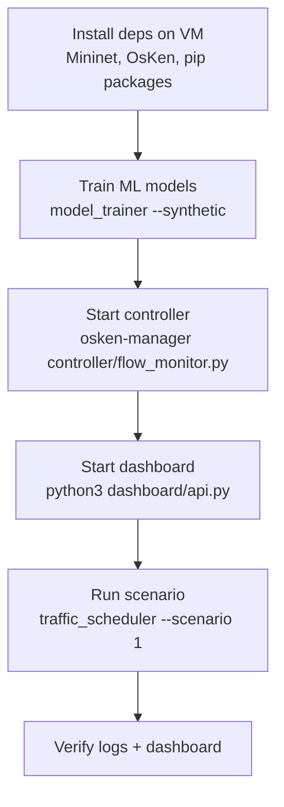
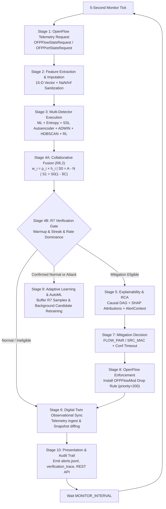
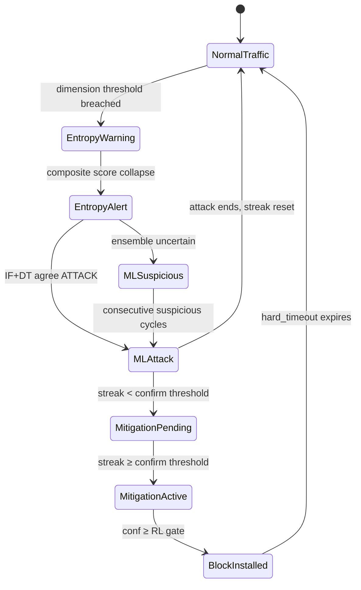
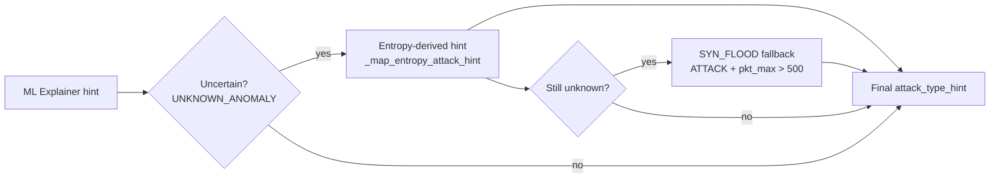
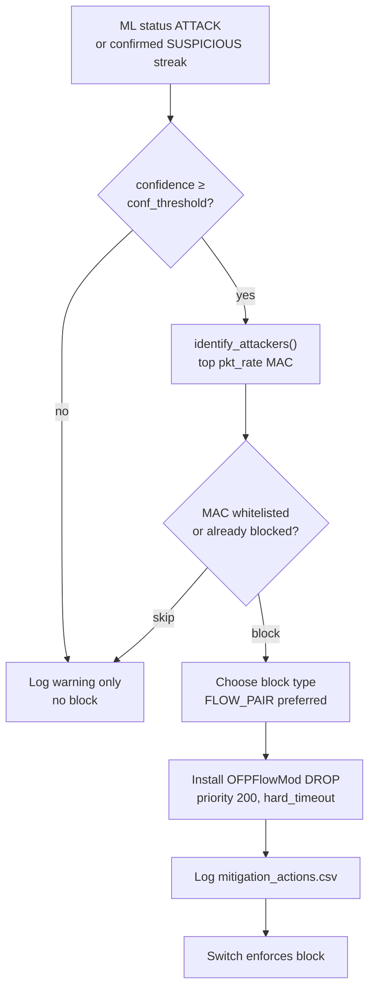
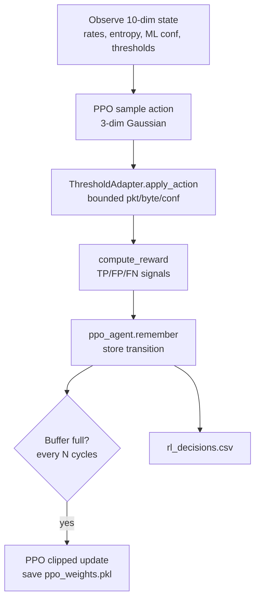
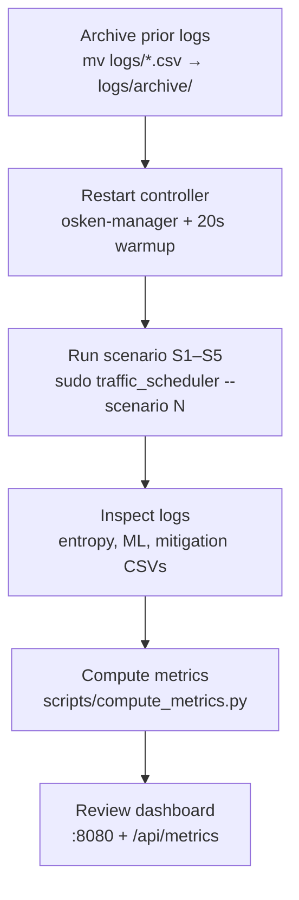
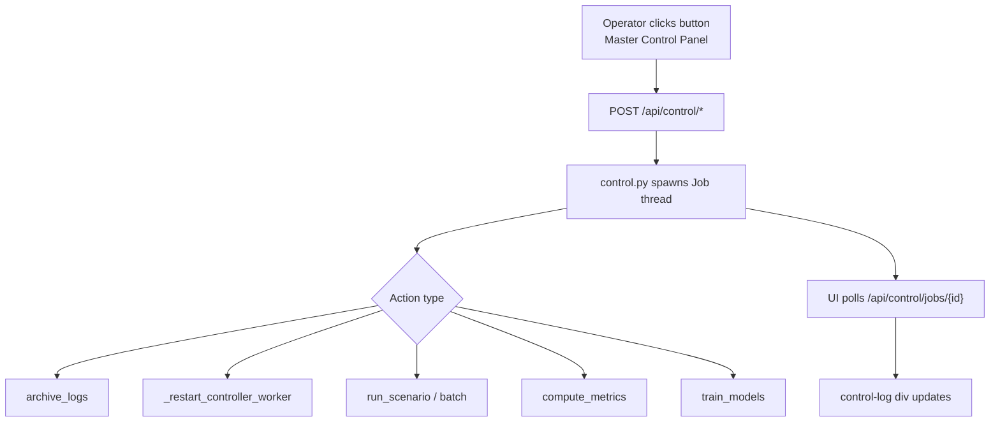
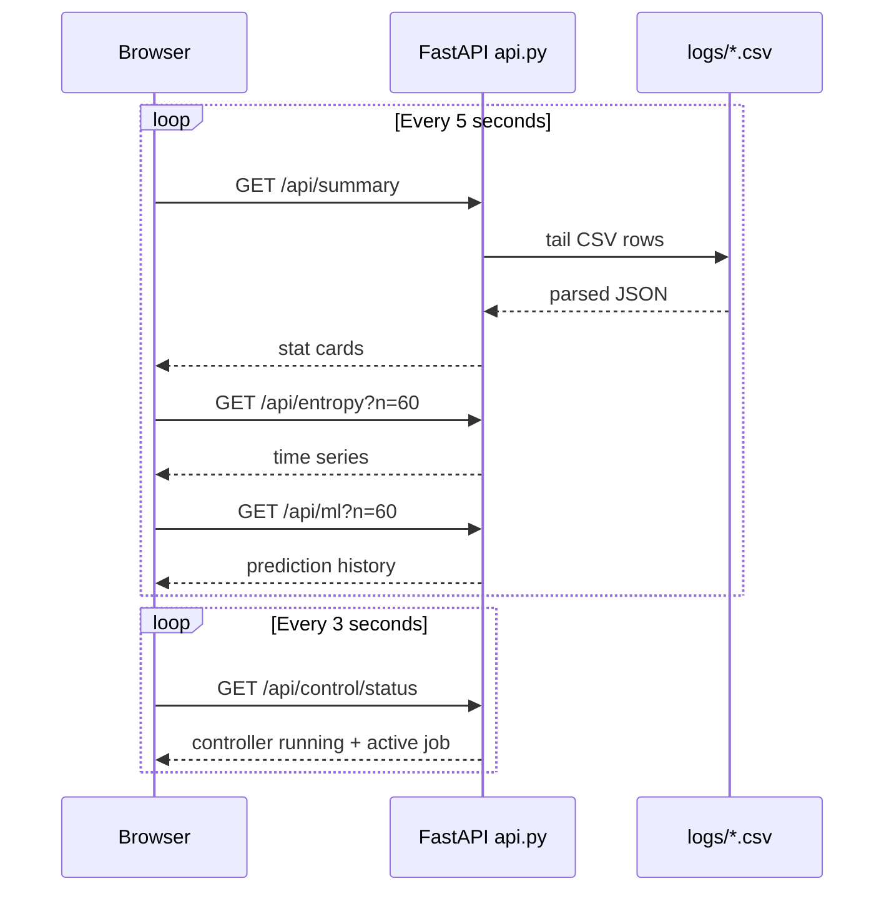

# Workflow

## 1. System Lifecycle Workflows

### 1.1 Cold Start (First Run)

### 1.2 Steady-State 10-Stage Closed-Loop Monitoring Cycle

Every **5 seconds** per connected switch:

---

## 2. Detection Workflow

### 2.1 Multi-Stage Detection Pipeline

### 2.2 Attack Type Hint Resolution

---

## 3. Mitigation Workflow

**Timeout tiers:**

| ML Confidence | Block Duration |
|---------------|----------------|
| ≥ 90% | 120 s |
| ≥ 75% | 60 s |
| ≥ 60% | 30 s |
| < RL conf gate | No block |

---

## 4. Reinforcement Learning Workflow

RL runs **online** during live monitoring — thresholds adapt continuously based on recent detection outcomes.

---

## 5. Experiment Workflow (Manual)

---

## 6. Experiment Workflow (Master Control UI)

**Batch eval flow** (`Run S3+S4+S5`):

1. Archive existing logs
2. Restart controller with 20 s warmup
3. Run scenarios 3, 4, 5 sequentially
4. Execute `compute_metrics.py`
5. Write `logs/metrics_report.json`

---

## 7. Dashboard Refresh Workflow

---

## 8. Scenario Ground-Truth Workflow (Phase 3)

Each scenario writes lifecycle events to `scenario_logs.csv`:

| Event | Meaning |
|-------|---------|
| `SCENARIO_START` | Scenario name and profile logged |
| `ATTACK_START` / `ATTACK1_START` | Ground-truth attack onset |
| `ATTACK_STOP` / `ATTACK1_STOP` | Attack cessation (including S4 burst after auto-stop) |
| `SCENARIO_END` | Scenario complete |

`compute_metrics.py` uses these windows to measure:

- **Detection latency** — first entropy/ML alert after `ATTACK_START`
- **Mitigation latency** — first BLOCK after `ATTACK_START`
- **False positives** — blocks during non-attack windows

---

## 9. Failure and Recovery Workflows

| Failure | Detection | Recovery |
|---------|-----------|----------|
| Controller crash | Dashboard shows controller stopped | Master Control → Restart Controller |
| Corrupt CSV headers | `compute_metrics` header fallback | Archive logs, restart controller |
| ML models missing | Controller auto-trains synthetic on startup | `train_models` from UI |
| Scenario sudo denied | Job log shows permission error | Configure `/etc/sudoers.d/intellishield` |
| Stale logs mixing runs | Inflated latency metrics | Archive before each experiment batch |
